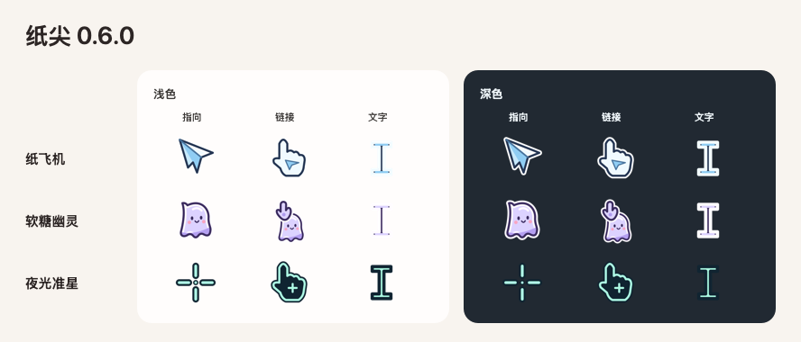

# Tipwink

**A little character for your Mac cursor.**

Give your pointer a paper cat, a folded plane, or a look of your own. Try it on light and dark backgrounds and see your changes take effect on the desktop.

**[Download for Mac](https://github.com/rendeyuwei/Tipwink/releases)** · [简体中文](README.zh-CN.md)

Apple Silicon · macOS 26 or later · Pilot build



## Find your cursor

| Theme | What makes it yours |
| --- | --- |
| **Paper Cat** | Click to see it blink. In Cat Only mode, the ear points and a paw comes up over links. |
| **Pixel Jelly** | Chunky pixels in grape and mint. |
| **Two-Tone Arrow** | Pick your own fill and outline colors. |
| **Paper Plane** | A folded paper pointer with its nose at the click point. |
| **Gummy Ghost** | A soft lilac ghost that raises a hand over links. |
| **Night Crosshair** | Mint marks around a clear center point for precise clicks. |

## Try it on your Mac

1. Download the `Tipwink-…-macOS-arm64.zip` asset from the release page, then unzip and open **Tipwink** (纸尖).
2. Choose a theme and preview its pointer, link, and text cursors. You can test clicks, links, text selection, and dragging, and set the size from 75% to 150%.
3. Choose **Apply to Desktop** (应用到桌面). Theme, style, size, and color changes apply as you make them. Use **Restore Original Cursor** (恢复原光标) in the window or menu bar to switch back.

Already running the pilot? Choose **Check for Updates…** (检查更新…) from the app menu or menu bar.

The pilot ZIP uses Apple Development signing. Public distribution requires a Developer ID signed and notarized build. Apps that draw their own cursors and some system screens may show a different pointer.

## Build and publish

Open [Tipwink.xcodeproj](Tipwink.xcodeproj) in Xcode 26 or later and run the **Tipwink** scheme.

On the configured release Mac, increment the version and build number, then run this from the checkout root:

```sh
./scripts/release-pilot
```

The script builds, signs, and verifies the OSS pilot update. The same signed ZIP can also be attached to a GitHub release. [Release guide](docs/updates.md)

Tipwink's cursor artwork is drawn in the project. Its theme library and interactive preview took inspiration from [MaCursor](https://writronic.com/macursor/) and [CursorMagic](https://pocketgiant.co/software/cursormagic/).
