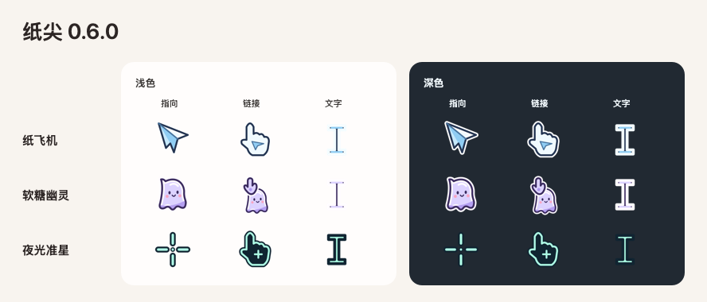

# 纸尖 · Tipwink

**给 Mac 换个有趣的光标。**

让纸片猫陪你点击，换一架用机鼻指向的纸飞机，或者搭一套自己的双色指针。在浅色和深色背景里试一试，喜欢的样式可以实时用到桌面。

**[下载 Mac 内测版](https://github.com/rendeyuwei/Tipwink/releases)** · [English](README.md)

适用于 Apple 芯片 Mac · macOS 26 或更新版本



## 六套光标主题

| 主题 | 特色 |
| --- | --- |
| **纸片猫** | 点一下会眨眼。纯猫模式用耳尖指向，移到链接上会抬爪。 |
| **像素果冻** | 葡萄紫和薄荷绿的像素光标。 |
| **双色箭头** | 填充和描边可以分别选色。 |
| **纸飞机** | 用折纸机鼻对准点击位置。 |
| **软糖幽灵** | 圆润的淡紫小幽灵，移到链接上会抬手。 |
| **夜光准星** | 薄荷色刻线围出清晰的中心点，方便精确对位。 |

## 开始使用

1. 在 Release 页面下载 `Tipwink-…-macOS-arm64.zip`，解压后打开「纸尖」。
2. 选一套主题，预览指向、链接和文字三种光标。试用区可以点击按钮和链接、选字和拖动，大小可调到 75% 至 150%。
3. 点击「应用到桌面」。主题、样式、大小和配色会即时生效。要切回去，在窗口或菜单栏点「恢复原光标」。

已经安装内测版？在应用菜单或菜单栏选择「检查更新…」。

内测安装包使用 Apple Development 签名。公开分发前需要 Developer ID 签名和 Apple 公证。自行绘制指针的应用和部分系统界面可能显示不同的光标。

## 构建与发版

用 Xcode 26 或更新版本打开 [Tipwink.xcodeproj](Tipwink.xcodeproj)，运行 **Tipwink** scheme。

在已配置的发版 Mac 上递增版本号和构建号，然后从仓库根目录运行：

```sh
./scripts/release-pilot
```

脚本会构建、签名并验证 OSS 内测更新。同一份签名 ZIP 也可以作为 GitHub Release 的下载附件。[发布指南](docs/updates.md)

所有光标图形均在本工程内绘制。主题库和试用区参考了 [MaCursor](https://writronic.com/macursor/) 和 [CursorMagic](https://pocketgiant.co/software/cursormagic/)。
