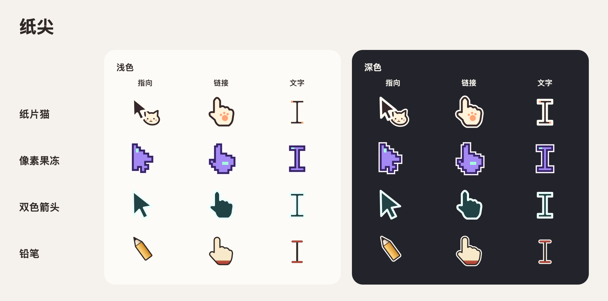

# 纸尖 · Tipwink

**一款常驻菜单栏的 macOS 光标主题应用。**

在浅色和深色背景下试用普通指针、链接手形和文字光标，再将喜欢的主题应用到桌面。

**[下载 Mac 版](https://github.com/rendeyuwei/Tipwink/releases/latest/download/Tipwink-macOS-arm64.zip)** · [产品页](https://rendeyuwei.github.io/Tipwink/zh-cn/) · [发行说明](https://github.com/rendeyuwei/Tipwink/releases/latest) · [English](README.md)

搭载 Apple 芯片的 Mac · macOS 26 或更高版本

[在浏览器里试用四套光标](https://rendeyuwei.github.io/Tipwink/zh-cn/#preview)

## 开始使用

1. 下载并解压 `Tipwink-macOS-arm64.zip`，将 `Tipwink.app` 移到「应用程序」，然后打开。
2. 选一套主题，在试用区试点按钮、预览链接手形、选字或拖动。光标大小可在 75% 至 150% 之间调整。
3. 点击「应用到桌面」。应用后，调整主题、样式、大小和配色会即时生效。

点击菜单栏的光标图标，可以重新打开主题库或切换主题。要换回原光标，在主题库窗口或菜单栏选择「恢复原光标」。

更新时，退出纸尖，用最新安装包中的应用替换「应用程序」里的纸尖。[发行说明](https://github.com/rendeyuwei/Tipwink/releases/latest)

## 光标主题

| 主题 | 样式 |
| --- | --- |
| **纸片猫** | 点击时眨眼。切到「纯猫」后，用耳尖定位，指向链接时抬爪。 |
| **像素果冻** | 葡萄紫的像素光标，配薄荷绿点缀。 |
| **双色箭头** | 经典指针造型，可分别调整填充色和描边色。 |
| **铅笔** | 琥珀色短铅笔，点击落点在笔尖。 |

## 兼容性

桌面主题作用于 macOS 的系统光标。部分应用和系统界面会显示自己的光标。

macOS 自定义指针颜色会覆盖桌面主题。如果纸尖显示「重设后应用…」，点开后在「显示」设置的「指针」一栏选择「重设颜色」，再返回纸尖即可应用选中的主题。[Apple 指针设置指南](https://support.apple.com/zh-cn/guide/mac-help/mchlp2920/mac)

下载包使用 Developer ID 签名，并通过 Apple 公证。

## 问题与反馈

如果遇到光标问题，请附上 macOS 版本、纸尖版本、选中的主题，以及问题出现的应用或界面。[提交问题或建议](https://github.com/rendeyuwei/Tipwink/issues)

## 从源码构建

用 Xcode 26 或更新版本打开 `Tipwink.xcodeproj`，选择 **Tipwink** 方案和 **My Mac**，然后运行。[Xcode 工程](Tipwink.xcodeproj) · [发布与更新指南](docs/updates.md)

## 致谢

纸尖的光标由代码绘制。主题库和试用区参考了 MaCursor 和 CursorMagic。[MaCursor](https://writronic.com/macursor/) · [CursorMagic](https://pocketgiant.co/software/cursormagic/)
